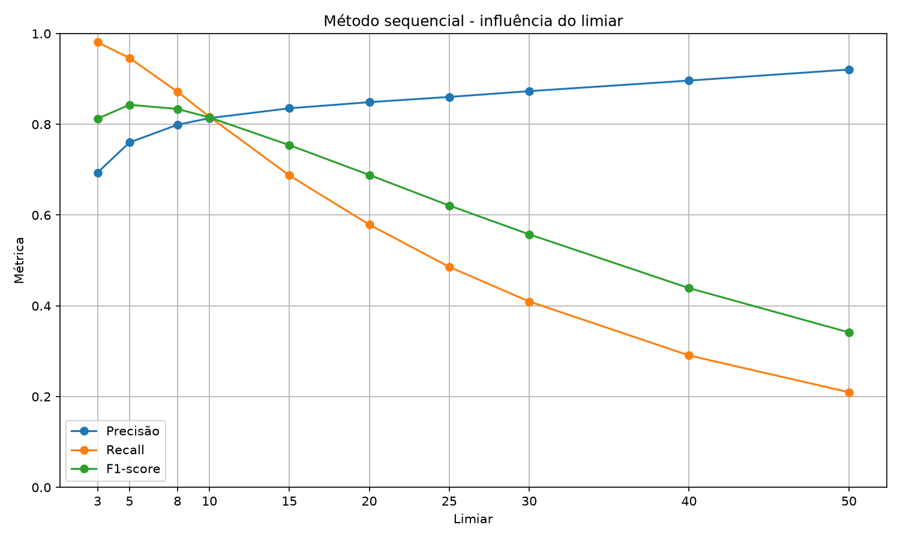
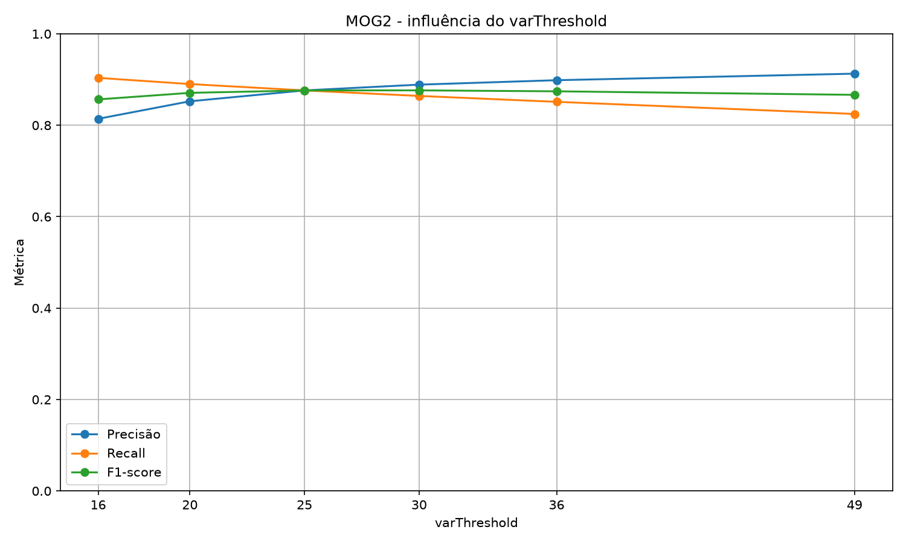
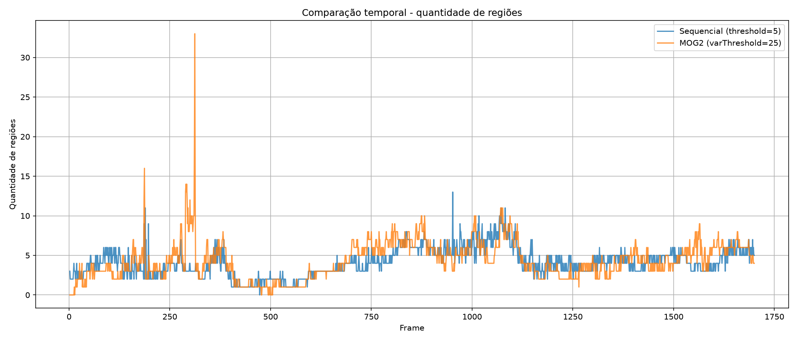
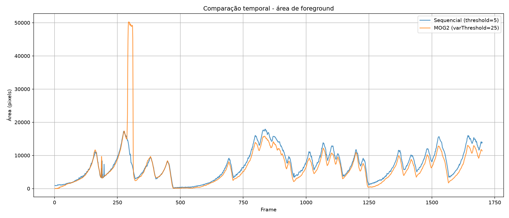
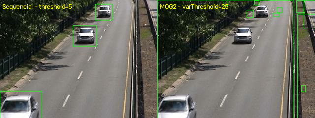
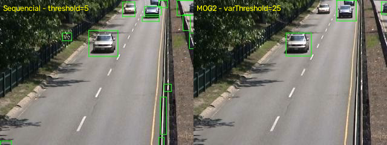

# Relatório Técnico — Detecção de movimento em videomonitoramento

## 1. Introdução

Este trabalho investiga a detecção de movimento em uma sequência de videomonitoramento de uma rodovia. Foram implementadas e comparadas duas abordagens clássicas de processamento de imagens: a diferença entre frames consecutivos e a subtração adaptativa de fundo MOG2, disponível no OpenCV.

O objetivo não é reconhecer semanticamente veículos, mas identificar regiões da imagem que apresentam movimento em relação à cena. Portanto, outros elementos móveis ou mudanças visuais, como vegetação movimentada pelo vento, também podem ser classificados como foreground.

### 1.1 Pergunta de pesquisa

Como a modelagem adaptativa do fundo (MOG2) se compara à diferença entre frames consecutivos na detecção de regiões em movimento em um vídeo de rodovia, considerando precisão, recall, F1-score e tempo de processamento?

### 1.2 Hipótese

A hipótese inicial é que a modelagem adaptativa do fundo tende a alcançar melhor equilíbrio entre precisão e recall, pois aprende progressivamente as características do cenário e distingue elementos persistentes de alterações temporárias.

Em contrapartida, espera-se que essa melhoria tenha um custo computacional maior em comparação com a diferença entre frames consecutivos.

## 2. Base de dados

Foi utilizada a sequência **Highway**, da categoria **Baseline** do CDnet 2014 — Change Detection Benchmark.

A sequência contém 1.700 frames de uma rodovia filmada por uma câmera fixa, com resolução de 320 × 240 pixels.

O conjunto fornece uma máscara de *ground truth* para cada frame, além de uma região espacial de interesse (ROI) e um intervalo temporal de avaliação.

O arquivo `temporalROI.txt` define o intervalo de avaliação entre os frames 470 e 1700.

Os rótulos das máscaras são:

| Valor | Significado | Tratamento |
|---|---|---|
| 0 | Fundo | Avaliado |
| 255 | Movimento | Avaliado |
| 50 | Sombra | Ignorado |
| 170 | Região desconhecida | Ignorado |
| 85 | Fora da ROI | Ignorado |

Somente pixels dentro da ROI e com rótulos válidos entram no cálculo das métricas.

Fonte: [CDnet 2014](https://changedetection.vitalab.usherbrooke.ca/dataset2014/).

## 3. Metodologia

### 3.1 Pré-processamento comum

Para permitir uma comparação controlada, os dois métodos utilizam o mesmo pré-processamento:

1. Conversão do frame para escala de cinza.
2. Aplicação de desfoque Gaussiano com kernel 5 × 5.

Depois da geração da máscara de movimento, ambos aplicam:

1. Filtro da mediana com kernel 5 × 5.
2. Duas iterações de dilatação.
3. Extração de contornos externos.
4. Descarte de contornos com área inferior a 50 pixels.
5. Construção de caixas delimitadoras (`boundingRect`) para as regiões restantes.

A quantidade de regiões e a área de foreground, calculada pela quantidade de pixels brancos da máscara, são registradas por frame em arquivos CSV.

### 3.2 Método sequencial: diferença entre frames consecutivos

O método compara o frame atual com o frame imediatamente anterior, utilizando `absdiff`.

A diferença absoluta é submetida a uma limiarização binária: pixels cuja diferença supera o limiar são classificados como movimento.

O parâmetro selecionado foi `limiar = 5`.

Um limiar menor aumenta a sensibilidade a pequenas mudanças, mas também pode classificar ruído como movimento. Um limiar maior tende a reduzir falsos positivos, porém pode deixar de detectar parte do movimento real.

Uma limitação inerente à estratégia é que ela responde a mudanças entre dois instantes consecutivos. Assim, pode destacar principalmente as bordas de objetos em movimento e deixar de detectar um veículo que permaneça parado.

### 3.3 Método adaptativo: MOG2

O segundo método utiliza `cv2.createBackgroundSubtractorMOG2`, que mantém um modelo estatístico do fundo e o atualiza ao longo da sequência.

A máscara gerada pelo modelo é submetida ao mesmo pós-processamento e à mesma extração de regiões utilizados no método sequencial.

Parâmetros utilizados:

| Parâmetro | Valor |
|---|---:|
| `history` | 500 |
| `varThreshold` | 25 |
| `detectShadows` | `False` |

O modelo recebe os frames desde o início da sequência, inclusive antes do início do intervalo de avaliação.

O parâmetro `varThreshold` controla o critério estatístico de classificação do pixel em relação ao modelo. Seu valor não é diretamente comparável ao limiar de diferença do método sequencial.

### 3.4 Seleção de parâmetros

Foram testados os seguintes valores:

- **Método sequencial:** `limiar` = 3, 5, 8, 10, 15, 20, 25, 30, 40 e 50.
- **MOG2:** `varThreshold` = 16, 20, 25, 30, 36 e 49, mantendo `history = 500` e `detectShadows = False`.

A seleção considerou precisão, recall, F1-score e tempo médio de processamento.

Entre os valores testados, o método sequencial selecionou limiar 5. Para MOG2, foi selecionado `varThreshold = 25`, que apresentou F1 igual a 0,876, empatado com o valor 30 nos resultados registrados, mas com recall ligeiramente maior.

**Limitação experimental importante:** os mesmos frames com *ground truth* (470–1700) foram utilizados tanto para selecionar os parâmetros quanto para calcular os resultados apresentados. Portanto, os números desta versão são exploratórios e não representam uma avaliação final em um conjunto independente.

A separação entre ajuste e avaliação final ainda precisa ser realizada.

## 4. Critérios de avaliação

A avaliação é feita por pixel, comparando a máscara prevista com o *ground truth* nos frames do intervalo definido pelo dataset.

- **Verdadeiro positivo (TP):** pixel previsto como movimento e rotulado como movimento no *ground truth*.
- **Falso positivo (FP):** pixel previsto como movimento, mas rotulado como fundo.
- **Falso negativo (FN):** pixel rotulado como movimento, mas não detectado pelo método.

As métricas são calculadas por:

\[
\text{Precisão} = \frac{TP}{TP + FP}
\]

\[
\text{Recall} = \frac{TP}{TP + FN}
\]

\[
F1 = 2 \cdot \frac{\text{Precisão} \cdot \text{Recall}}
{\text{Precisão} + \text{Recall}}
\]

A precisão indica a proporção das detecções positivas que correspondem a movimento real.

O recall indica a proporção do movimento real que foi detectada.

O F1-score combina as duas métricas por meio da média harmônica.

### 4.1 Tempo de processamento

O tempo de processamento é medido com `time.perf_counter()`.

A medição considera as operações de processamento de imagem, incluindo pré-processamento, geração da máscara, pós-processamento, extração de contornos e cálculo da área e quantidade de regiões.

São excluídos da medição:

- Leitura dos frames do disco.
- Leitura das máscaras de *ground truth*.
- Desenho das caixas delimitadoras.
- Gravação dos vídeos e arquivos de saída.

O tempo médio é calculado dividindo o tempo acumulado pelo número de frames cronometrados.

## 5. Resultados

### 5.1 Seleção do limiar do método sequencial

Foram avaliados dez limiares. O melhor F1 entre os valores testados ocorreu com `limiar = 5`.

O resultado mostra o compromisso entre precisão e recall: limiares menores favorecem a detecção de mais pixels de movimento, mas também aumentam a quantidade de falsos positivos.

O limiar 5 apresentou o maior F1 entre as configurações testadas.

### 5.2 Seleção do parâmetro do MOG2

Os valores 25 e 30 alcançaram F1 de 0,876 nos resultados registrados.

O valor 25 foi escolhido por apresentar recall um pouco maior, mantendo o mesmo F1.

### 5.3 Comparação dos métodos selecionados

| Método | Precisão | Recall | F1-score | Tempo médio |
|---|---:|---:|---:|---:|
| Sequencial (`limiar=5`) | 0,760 | 0,946 | 0,843 | 0,44 ms/frame |
| MOG2 (`varThreshold=25`) | 0,876 | 0,876 | 0,876 | 1,75 ms/frame |

Os resultados exploratórios indicam comportamentos diferentes:

- O método sequencial apresentou recall mais alto (0,946), detectando uma proporção maior dos pixels de movimento real, mas também apresentou menor precisão (0,760).
- O MOG2 apresentou maior precisão (0,876) e F1 (0,876), com equilíbrio entre precisão e recall.
- O MOG2 levou aproximadamente quatro vezes mais tempo por frame do que o método sequencial nas medições registradas.

Esses resultados são compatíveis com a hipótese de que o modelo adaptativo pode produzir uma detecção mais equilibrada, com custo computacional maior.

A conclusão, contudo, deve ser tratada como preliminar até que seja feita uma avaliação em frames separados daqueles usados para ajuste.

### 5.4 Comparação temporal das saídas

Os arquivos CSV registram a quantidade de regiões e a área de foreground detectadas por frame.

Os gráficos a seguir permitem observar como os métodos se comportam ao longo da sequência.

Foram observadas divergências expressivas entre os métodos em alguns trechos, especialmente entre os frames 300 e 313.

No frame 310, por exemplo, a área detectada pelo método sequencial foi de 6.625 pixels, enquanto a área detectada pelo MOG2 foi de 49.107 pixels.

No frame 312, o sequencial detectou 3 regiões e o MOG2 detectou 33.

Essas diferenças indicam que os métodos respondem de forma distinta a determinadas mudanças da cena.

Entretanto, a diferença entre duas máscaras não permite concluir, isoladamente, qual delas está correta: é necessário considerar o *ground truth* e o contexto visual do frame.

### 5.5 Inspeção visual de frames

As imagens abaixo são capturas sincronizadas dos vídeos anotados, com a saída sequencial à esquerda e a saída MOG2 à direita.

**Frame 310 — divergência expressiva na área de foreground**

**Frame 952 — outro padrão de divergência entre as regiões detectadas**

As capturas ajudam a localizar e interpretar diferenças entre as saídas, mas não substituem a comparação pixel a pixel com o *ground truth*.

Os retângulos indicam regiões detectadas pelos algoritmos, não classificações semânticas de veículos.

## 6. Discussão

A diferença entre frames consecutivos é computacionalmente mais simples e apresentou o menor tempo médio.

Seu recall elevado sugere que detecta grande parte do movimento presente no *ground truth*, mas sua precisão menor indica maior quantidade de pixels classificados como movimento sem correspondência no *ground truth*.

O MOG2 apresentou maior precisão e F1, mas exigiu mais processamento.

A manutenção de um modelo adaptativo do fundo permite que o algoritmo considere o histórico da cena, em vez de depender exclusivamente da diferença entre dois frames adjacentes.

Nenhuma das abordagens realiza reconhecimento de veículos. A movimentação de elementos do cenário, alterações de iluminação e ruídos podem influenciar as máscaras.

Além disso, as métricas são calculadas por pixel; elas não medem diretamente a capacidade de contar veículos ou associar cada caixa delimitadora a um objeto real.

Por fim, os tempos registrados dependem do ambiente de execução e da definição do trecho cronometrado. A comparação é útil porque os métodos foram executados no mesmo projeto e com o mesmo escopo de medição, mas os valores não devem ser interpretados como benchmarks universais.

## 7. Conclusão

Nos experimentos exploratórios realizados, o método sequencial apresentou maior recall e menor custo computacional, enquanto o MOG2 apresentou melhor precisão e F1-score, com tempo médio aproximadamente quatro vezes maior.

Assim, a escolha entre os métodos depende da prioridade da aplicação.

Quando a rapidez e a recuperação de grande parte do movimento são prioritárias, a diferença entre frames consecutivos pode ser atraente.

Quando se busca maior equilíbrio entre precisão e recall, o MOG2 mostrou resultados melhores neste conjunto de experimentos.

A principal etapa experimental pendente é separar os dados de ajuste dos dados de avaliação final. Depois dessa separação, os parâmetros devem ser selecionados somente no conjunto de ajuste e os resultados finais devem ser calculados uma única vez no conjunto reservado para teste.

## 8. Referências

- WANG, Y. et al. **CDnet 2014: An Expanded Change Detection Benchmark Dataset**. IEEE Conference on Computer Vision and Pattern Recognition Workshops (CVPRW), 2014.
- OpenCV. [Documentação oficial](https://docs.opencv.org/).
- OpenCV. [BackgroundSubtractorMOG2](https://docs.opencv.org/4.x/d7/d7b/classcv_1_1BackgroundSubtractorMOG2.html).